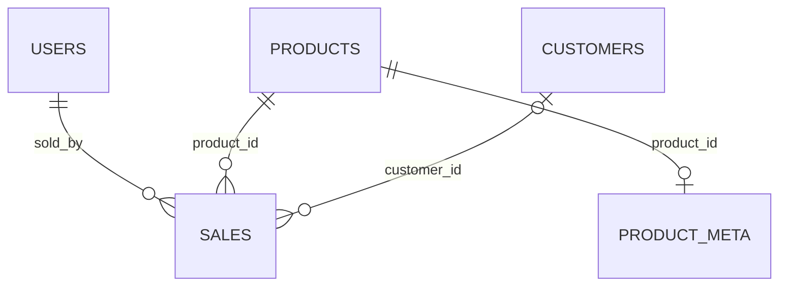

# Matchaya Point of Sale

Matchaya is a CodeIgniter 4 point-of-sale application for a sample matcha café and the IT0049 Web System Technologies midterm project. Staff can manage products, customers, and accounts, record sales without overselling, and review sales history. The menu and sales in the seeder are illustrative sample data, not actual café records.

The application uses PHP 8.2 or newer, CodeIgniter 4.7, MySQL or MariaDB, server-rendered HTML, CSS, and small vanilla JavaScript. Its timezone is `Asia/Manila`; money is displayed in Philippine pesos.

## Features and grading evidence

| Rubric area | Implementation |
|---|---|
| Architecture and design | Explicit `app/Config/Routes.php`, one Model per table, migrations and seeders, `SaleService` for stock-safe transactions, responsive counter layout, 17 product-specific generated images with a manifest. |
| Feature completeness | Product, customer, and staff CRUD; single-item sale form; multi-item POS cart; sales history and receipts. |
| Validation and security | Validated forms and images, password hashes, CSRF, auth filter, bounded uploads outside `public/`, guarded deletion, transaction rollback. |
| Code quality | Controllers prepare responses; Models and services handle queries and business rules; views escape displayed values. |
| Documentation and deployment | This README, `docs/design.md`, `docs/technical.md`, image manifest, Word guide, migrations, SQL export, and an InfinityFree deployment path. |

## Local setup with XAMPP on Windows

1. Start MySQL in XAMPP. Create an empty MySQL database named `matchaya_pos` with `utf8mb4` encoding, or choose another name and set it in `.env`.
2. Copy `.env.example` to `.env`. Check the database host, user, password, port, and `app.baseURL`. Do not commit `.env`.
3. Install dependencies with Composer: `composer install`. XAMPP PHP must have `mysqli`, `intl`, `gd`, `mbstring`, `fileinfo`, and `openssl` available.
4. In this directory, run `C:\xampp\php\php.exe -d extension=php_intl.dll -d extension=php_gd.dll spark migrate --all`.
5. To load sample menu, customers, two staff accounts, and 14 days of illustrative sales, run `C:\xampp\php\php.exe -d extension=php_intl.dll -d extension=php_gd.dll spark db:seed MatchaSeeder`. The seeder prints random temporary passwords for `counter1` and `counter2` once. Save them when the command runs. No fixed plaintext password or known hash is committed.
6. Double-click `Start-Matchaya.cmd` or run `C:\xampp\php\php.exe -d extension=php_intl.dll -d extension=php_gd.dll -S 127.0.0.1:8084 -t public vendor\codeigniter4\framework\system\rewrite.php`.
7. Open `http://localhost:8084/`. Without seed accounts, the first visit goes to `/setup` to create the first account. With seed accounts, sign in with a generated password.

Use either migrations or `database/matcha_pos.sql` for a fresh schema. The SQL export creates the same six tables but does not insert sample records or CodeIgniter's migration tracking row. Prefer migrations for an environment that will receive future updates. The seeder skips tables that already contain data, so repeat runs do not duplicate the sample set.

## Pages and routes

| Page | Route | Purpose |
|---|---|---|
| First account | `GET/POST /setup` | Creates the first staff account only when no account exists. |
| Sign in | `GET/POST /login` | Verifies the stored password hash. |
| Counter | `/` or `/pos` | Category menu, cart, and charge. |
| Dashboard | `/dashboard` | Revenue, order volume, hourly shape, top sellers, customer and stock indicators. |
| Products | `/products` | Menu CRUD and restock. |
| Customers | `/customers` | Customer CRUD and derived stamp display. |
| Staff | `/staff` | Staff CRUD and avatar management. |
| My account | `/account` | Signed-in account. |
| Simple sale | `/sales/new` | Single-product form that works without JavaScript. |
| Sales history | `/sales` | Filtered, paginated sale lines and CSV export. |
| Receipt | `/sales/receipt/{saleId}` | Printable grouped order. |
| About | `/about` | Project details. |

All management routes, including their POST actions and logout, are in the `auth` route group. Only setup, login, and the validated image route are outside it. Run `php spark routes` to inspect the applied filters.

## Database design

The four assignment tables are `products`, `customers`, `users`, and `sales` with the exact required columns and relationships. `users.password` stores a hash. The optional `product_meta` table holds category, description, and featured placement without changing the assignment's `products` fields. `ci_sessions` stores sessions on Vercel. The app can run when `product_meta` is empty or absent; categories collapse to All and drink loyalty falls back to all purchased items.

The required `sales` schema has one product per row and no order ID. A multi-item order inserts several rows in one transaction with the same `created_at`, `sold_by`, and `customer_id`. A receipt groups on those values. Two orders by the same staff for the same customer within one second can group together; a production system should add a real order identifier when the schema permits it. This assignment keeps the required schema.

`SaleService` locks product rows in numeric ID order, checks available stock, conditionally decreases stock, calculates `total_price = current price × quantity` on the server, and inserts sale lines within the same transaction. A failed line rolls back every line. The staff ID always comes from the session.

## Images and storage

Product and staff forms accept JPEG, PNG, or WebP images up to 2 MB and 4096 pixels per side. `MediaStorage` checks the actual MIME type, uses a random temporary name, prepares square JPEGs with CodeIgniter's GD image service (640×640 for products, 256×256 for avatars), and discards the raw file. JPEG EXIF orientation is applied where PHP's EXIF extension is available. The processed file has no source metadata. The database stores only a generated filename or a Cloudinary HTTPS URL.

`MEDIA_DRIVER=local` saves to `writable/uploads`, outside the executable public directory. A narrow `/media/{products|avatars}/{filename}` route serves only generated JPEG names. The seeded product images are committed static WebP assets in `public/assets/demo/products/`: 640 px tiles and 1280 px variants selected with `srcset`. The seeder maps each product to `demo/products/{slug}.webp`; `media_url()` resolves this prefix to `/assets/` and continues to route uploaded filenames through `/media/`. These sample depictions are generated, local, and documented in `docs/IMAGE-CREDITS.md` and `database/seeds/image-manifest.json`. To replace a source, update the manifest's `source_file` and run `python tools/build_demo_images.py` with Pillow. The image set has 17 products because the brief names 17 distinct items while also suggesting a 12–16 range; the chawan was retained so every named item is represented. The sign-in and About still lifes are stored under `public/assets/brand/`. `vercel.json` sends `/assets/*` to `public/assets/*`, covering all static demo files.

For a host with ephemeral storage such as Vercel, set `MEDIA_DRIVER=cloud`, `CLOUDINARY_CLOUD_NAME`, `CLOUDINARY_API_KEY`, and `CLOUDINARY_API_SECRET`. When GD is available, the prepared JPEG is uploaded over HTTPS. When the host lacks GD, the cloud driver asks Cloudinary for an incoming square JPEG transformation before storing the original asset. The database stores the returned secure URL. Cloud storage requires an account and credentials, so it cannot be exercised by a local `MEDIA_DRIVER=local` test.

## Security

All changes use POST and `csrf_field()`. The global CSRF filter and `secureheaders` filter are enabled. Staff passwords are hashed with `password_hash()` and verified with `password_verify()`; sessions regenerate on sign-in and store only the account ID. The session cookie is HTTP-only and SameSite Lax, and production enables secure cookies and HTTPS redirects. Login attempts are limited to five per minute per IP through CodeIgniter's file-backed Throttler locally. For a serverless deployment, use a shared cache or edge rate limit because local function storage does not provide a reliable shared throttle.

User content is escaped in views. Queries use Models, Query Builder, or bound SQL parameters. Product, customer, and staff records with sales cannot be deleted. A staff member cannot delete their own account or the last account. The Content Security Policy setting remains disabled while the dashboard uses inline SVG geometry and the receipt uses a print handler; `secureheaders` still applies. Review and enable a strict CSP before a public production launch.

## Design rationale

The source research described a calm, daytime matcha counter and busy staff who need a short path from menu to charge. That led to a matte foam surface, restrained text, one bright matcha fill, large product targets, one-tap add and undo, and a phone order sheet that keeps the charge flow within reach. The sample latte prices sit around the observed Metro Manila range; they are illustrative, not advertised shop prices. The 10-stamp customer display grants a labeled welcome stamp and does not imply that redemption is tracked. See `docs/design.md` for the wireframes, type choices, and revision notes.

## Known limits

- Senior citizen and PWD discounts and 12% VAT exemption are not calculated or recorded. A real Philippine restaurant deployment must handle those requirements and issue appropriate receipts; the assignment's `sales` table has no discount or tax fields.
- There is no payment method, tip, refund, or void record. A refund needs both a stock return and an audit record that the required schema cannot hold.
- There is no ingredient cost or profit calculation. The dashboard reports revenue and volume, not margin.
- The customer stamp card is display-only: one labeled welcome stamp plus one per drink unit. Redemption is not recorded.
- `product_meta` is optional. Without it, category tabs, food attach rate, and drink-only stamp counting are unavailable or use the documented fallback.
- A browser cart survives refresh through `sessionStorage` when enabled. The single-item form is the no-JavaScript path.
- The optional co-purchase suggestion strip, searchable POS customer picker, POS loyalty display, are not implemented. The three CRUD lists have search but not sort or pagination. The documented sale and stock path remains available without them.

## InfinityFree deployment

The localhost database and hosted database are separate MySQL databases. The hosted site uses its own `.env` with the MySQL hostname, database name, username, and password shown in the InfinityFree control panel. Do not enter `localhost` as the hosted DB hostname. This project includes `vendor/`, so Composer does not have to run on the host. The root `.htaccess` routes requests into `public/`, the only web-facing directory. See [docs/infinityfree.md](docs/infinityfree.md) for the exact dashboard, upload, database import, and smoke-check sequence.

**Live IT0049 sample:** [matchaya-it0049.page.gd](https://matchaya-it0049.page.gd/) on InfinityFree account `if0_43139444`, with its own database `if0_43139444_matchaya_pos`. The local XAMPP database is `matchaya_pos`. A separate hosted staff password is stored as a hash in the hosted database; the plaintext is supplied to the project owner outside this source package. See `docs/deployment-record.md` for the checks run on the live site.

On InfinityFree, use `CI_ENVIRONMENT=production`, `MEDIA_DRIVER=local`, and the site's HTTPS URL as `app.baseURL`. Product and avatar uploads persist in `writable/uploads` there. Keep the hosted `.env` private and out of the deliverable ZIP; create it during deployment. Create the hosted database in InfinityFree and import a fresh schema plus illustrative seed data. This does not change the local `matchaya_pos` database.

## Optional Vercel deployment

1. Create a GitHub repository from this directory. Commit raw source, migrations, seeders, `database/matcha_pos.sql`, documentation, and `composer.lock`. Keep `.env`, local uploads, and database dumps with personal data out of Git.
2. Provision a hosted MySQL database. Run `php spark migrate --all` with its credentials, or import the SQL export into an empty database. Create the first staff account at `/setup`; do not seed illustrative sales in a real shop.
3. In Vercel, import that repository with the project root at `./` and preset **Other**. `vercel.json` routes static assets and PHP requests through the included function entrypoint. This uses the community `vercel-php` runtime.
4. Set `CI_ENVIRONMENT=production`, `DB_HOST`, `DB_DATABASE`, `DB_USERNAME`, `DB_PASSWORD`, `DB_PORT`, `MEDIA_DRIVER=cloud`, and the three Cloudinary variables in Vercel. Redeploy after changing them. `ci_sessions` must exist for hosted sessions.
5. Open the deployment, create the account, upload an image, record a sale, and confirm history and stock. Add the working deployment and repository URLs to the course submission.

The course submission can use the InfinityFree URL. A GitHub repository still needs to be created in the owner's GitHub account; publish only source files, never `.env` or private database credentials.

## Verification

Use `php -l` on changed PHP files and `php spark routes` for route coverage. With a disposable database, run migrations and the seeder, then check authentication, a valid sale, an oversell, a cart rollback, uploads, guarded deletions, a blank password edit, and dashboard rendering. The local run on 10 October 2026 passed those checks; see `docs/verification.md` for exact results and checks not run. The packaged source can be checked again after installation on a different machine.

See `docs/design.md` for layout decisions, `docs/IMAGE-CREDITS.md` for every generated image, `docs/technical.md` for the request flow, and `docs/Matchaya-POS-Technical-Guide.docx` or `.pdf` for the printable midterm guide.
# Matchaya-Midterms-Project

# Matchaya-Midterms-Project

